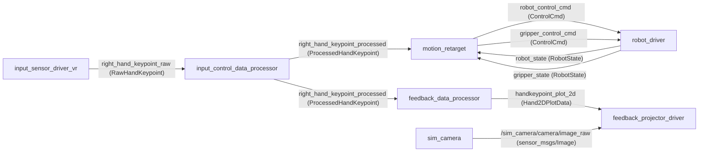

# System Interfaces

This document describes all message and service types defined in the `system_interfaces` package. These interfaces are the communication contract between all component nodes, the SystemManager, and any external orchestration scripts.

---

## Overview

The interfaces are split into two functional groups:

| Group | Purpose |
|---|---|
| **System Control** | Start, pause, and stop the entire system; query component states |
| **Component Lifecycle** | Send commands to individual component nodes; receive status updates |
| **Configuration** | Fetch runtime configuration data from the SystemManager |
| **Logging** | Route structured log messages from any node to persistent storage |
| **KPI Monitoring** | Start and stop Docker container resource monitoring sessions |
| **Data Collection** | Start and stop ROS 2 topic recording for demo datasets |

---

## Messages

### `system_interfaces/msg/ComponentStatus`

**Purpose:** Published by every `ComponentNode` to the `/component_states` topic to broadcast its current lifecycle state. The SystemManager subscribes to this topic to maintain a live registry of all active nodes and their states.

**Fields:**

| Field | Type | Description |
|---|---|---|
| `layer_cn_id` | `string` | The unique identifier of the component node publishing this status |
| `status` | `string` | Current lifecycle state. Valid values: `disconnected`, `ready`, `running`, `paused`, `stopped`, `error` |
| `timestamp` | `builtin_interfaces/Time` | ROS 2 timestamp of when this status was published |


**Nodes involved:**
- **Publishers:** All `ComponentNode` subclasses (every component in the system)
- **Subscribers:** `SystemManager`

---

## Services

### `system_interfaces/srv/SystemControl`

**Purpose:** The top-level system command interface. Sends a control instruction (`start`, `pause`, `urgent_stop`) to the SystemManager, which then broadcasts the command to all registered component nodes. This is the primary entry point for orchestration scripts.

**Request:**

| Field | Type | Description |
|---|---|---|
| `description` | `string` | Command to execute. Known values: `start`, `pause`, `urgent_stop` |

**Response:**

| Field | Type | Description |
|---|---|---|
| `success` | `bool` | Whether the command was accepted and dispatched |
| `system_state` | `string` | The resulting system-wide state after the command |
| `message` | `string` | Human-readable result or error description |
| `timestamp` | `builtin_interfaces/Time` | When the response was generated |

**Nodes involved:**
- **Server:** `SystemManager`
- **Clients:** Orchestration scripts, external controllers

**Example:**
```bash
ros2 service call /system_control \
  system_interfaces/srv/SystemControl \
  "{description: 'start'}"
```

---

### `system_interfaces/srv/ComponentService`

**Purpose:** Sends a lifecycle command directly to a specific component node. Called by the SystemManager when it needs to command individual nodes (e.g., as part of a system-wide `start` dispatch). Component nodes expose this service under the name `cn_srv_{layer_cn_id}`.

> **Note:** Monitor nodes and data collector nodes do **not** create a `ComponentService` server (see `component_node.py` line 76–77). They are controlled exclusively through their own dedicated services (`StartMonitor`, `StopMonitor`, etc.).

**Request:**

| Field | Type | Description |
|---|---|---|
| `command` | `string` | Lifecycle command. Valid values: `start`, `pause`, `urgent_stop`, `checkup` |
| `timestamp` | `builtin_interfaces/Time` | When the request was sent |
| `sender` | `string` | Identity of the caller (e.g., `"system_manager"`) |

**Response:**

| Field | Type | Description |
|---|---|---|
| `status` | `string` | The component's state after executing the command |
| `message` | `string` | Result description or error detail |
| `success` | `bool` | Whether the command executed without error |
| `timestamp` | `builtin_interfaces/Time` | When the response was generated |

**Nodes involved:**
- **Servers:** All `ComponentNode` subclasses (except monitors and data collectors), each exposing `cn_srv_{layer_cn_id}`
- **Clients:** `SystemManager`

---

### `system_interfaces/srv/Logging`

**Purpose:** Routes a structured log message from any component node to the SystemManager, which persists it to the appropriate log file. The `log_level` field is used not only as a severity indicator but also as a routing tag — monitor nodes set it to `MONITOR_{layer_cn_id}_{container_id}` to route KPI output to the correct log file.

**Request:**

| Field | Type | Description |
|---|---|---|
| `layer_cn_id` | `string` | The node sending the log |
| `log_level` | `string` | Severity (`DEBUG`, `INFO`, `WARN`, `ERROR`) or a structured routing tag (e.g., `MONITOR_monitor_ubuntu_simulator_f962a026f2e1`) |
| `message` | `string` | Log content |
| `timestamp` | `builtin_interfaces/Time` | When the event occurred |

**Response:**

| Field | Type | Description |
|---|---|---|
| `success` | `bool` | Whether the log was accepted and written |
| `message` | `string` | Error detail if logging failed |

**Nodes involved:**
- **Server:** `SystemManager`
- **Clients:** All `ComponentNode` subclasses via `self.logging(msg, log_level)`

---

### `system_interfaces/srv/GetConfig`

**Purpose:** Retrieves configuration data from the SystemManager's config store at runtime. Any component node can call this to fetch its own configuration or shared system configuration without reading files directly.

**Request:**

| Field | Type | Description |
|---|---|---|
| `layer_cn_id` | `string` | The requesting node's ID |
| `config_file_name` | `string` | Which config domain to query (e.g., `hardware`, `data_stream`, `demo`, `component_node.{name}`)|
| `config_keys` | `string[]` | Specific keys to retrieve. If empty, returns the entire config object |

**Response:**

| Field | Type | Description |
|---|---|---|
| `success` | `bool` | Whether the config was found and returned |
| `message` | `string` | Error detail on failure |
| `config_data` | `string` | JSON-serialized config content |

**Nodes involved:**
- **Server:** `SystemManager`
- **Clients:** All `ComponentNode` subclasses via helper methods (`load_hardware_config()`, `load_my_config()`, etc.)

---

### `system_interfaces/srv/StartMonitor`

**Purpose:** Instructs a `DockerMonitor` node to begin collecting resource metrics for one or more Docker containers. A ROS 2 timer (1 Hz) is created per container, and raw CPU and memory stats are buffered in memory until `StopMonitor` is called. The service is idempotent: requesting monitoring for an already-active container is silently skipped.

**Request:**

| Field | Type | Description |
|---|---|---|
| `container_ids` | `string[]` | Full Docker container IDs to begin monitoring |

**Response:**

| Field | Type | Description |
|---|---|---|
| `success` | `bool` | `true` if all requested containers were started without error |
| `container_ids` | `string[]` | Container IDs that were successfully started |
| `start_time` | `builtin_interfaces/Time` | ROS 2 timestamp when the service returned |
| `results_file_paths` | `string[]` | Paths where KPI logs will be written (one per container) |

**Nodes involved:**
- **Server:** `DockerMonitor` (one instance per container, at `/{layer_cn_id}/start_monitor`)
- **Clients:** Orchestration scripts, `ExperimentManager`

**Example:**
```bash
ros2 service call \
  /monitor_ubuntu_simulator/start_monitor \
  system_interfaces/srv/StartMonitor \
  "{container_ids: ['f962a026f2e1049d7fc4770703f3f742ecde8c7c18e49e721d8755f8ceee2429']}"
```


---

### `system_interfaces/srv/StopMonitor`

**Purpose:** Instructs a `DockerMonitor` node to stop collecting metrics for one or more containers. On receipt, the node destroys the per-container timer, post-processes all buffered samples (computing CPU percentages and memory breakdowns), emits a structured CSV log followed by a summary line, and releases all resources. The log is written both to the ROS 2 logger and routed through the `Logging` service to persistent storage.

**Request:**

| Field | Type | Description |
|---|---|---|
| `container_ids` | `string[]` | Full Docker container IDs to stop monitoring |

**Response:**

| Field | Type | Description |
|---|---|---|
| `success` | `bool` | `true` if all containers were stopped and logs flushed without error |
| `container_ids` | `string[]` | Container IDs that were successfully stopped |
| `start_time` | `builtin_interfaces/Time` | Timestamp field (populated at response time) |
| `results_file_paths` | `string[]` | Paths where the KPI logs were written |

**Nodes involved:**
- **Server:** `DockerMonitor` (at `/{layer_cn_id}/stop_monitor`)
- **Clients:** Orchestration scripts, `ExperimentManager`

**Example:**
```bash
ros2 service call \
  /monitor_ubuntu_simulator/stop_monitor \
  system_interfaces/srv/StopMonitor \
  "{container_ids: ['f962a026f2e1049d7fc4770703f3f742ecde8c7c18e49e721d8755f8ceee2429']}"
```

---

### `system_interfaces/srv/StartDataCollection`

**Purpose:** Instructs the data collector node to begin recording ROS 2 topics to disk for a named demo session. Topic list, video codec, and storage format can be specified explicitly; if omitted, defaults are loaded from the demo configuration file.

**Request:**

| Field | Type | Description |
|---|---|---|
| `demo_id` | `string` | Identifier for this recording session (e.g., `"HZ_90"`). Used to name the output directory and link config |
| `demo_root_path` | `string` | Root directory where the recording will be saved. Can be empty to use the config default |
| `topics` | `string[]` | List of ROS 2 topic names to record. Empty list records all topics defined in the data stream config |
| `video_codec` | `string` | Codec for any video streams (e.g., `"h264"`). Empty uses default |
| `storage_format` | `string` | Storage backend (e.g., `"mcap"`, `"sqlite3"`). Empty uses default |

**Response:**

| Field | Type | Description |
|---|---|---|
| `success` | `bool` | Whether recording started successfully |
| `topic_ids` | `string[]` | The topic names actually being recorded |
| `storage_path` | `string` | Full path to the directory where data is being written |
| `start_time` | `builtin_interfaces/Time` | When recording began |

**Nodes involved:**
- **Server:** `DataCollector` node (at `/start_data_collection`)
- **Clients:** Orchestration scripts, external users

**Example:**
```bash
# Start recording with demo_id only; all other fields use config defaults
ros2 service call /start_data_collection \
  system_interfaces/srv/StartDataCollection \
  "{demo_id: 'HZ_90'}"
```

---

### `system_interfaces/srv/StopDataCollection`

**Purpose:** Stops an active recording session for the specified demo. The data collector finalizes and closes all open bag files and returns the storage path and total duration of the session.

**Request:**

| Field | Type | Description |
|---|---|---|
| `demo_id` | `string` | The demo session identifier to stop (must match the one used in `StartDataCollection`) |

**Response:**

| Field | Type | Description |
|---|---|---|
| `success` | `bool` | Whether the session was stopped and data finalized |
| `storage_path` | `string` | Path to the completed recording |
| `collection_duration` | `builtin_interfaces/Duration` | Total elapsed recording time |
| `message` | `string` | Result description or error detail |

**Nodes involved:**
- **Server:** `DataCollector` node (at `/stop_data_collection`)
- **Clients:** Orchestration scripts, external users

**Example:**
```bash
ros2 service call /stop_data_collection \
  system_interfaces/srv/StopDataCollection \
  "{demo_id: 'HZ_90'}"
```

---

## Quick Reference

| Interface | Type | Server Node | Typical Client |
|---|---|---|---|
| `ComponentStatus` | msg | All `ComponentNode`s | `SystemManager` |
| `SystemControl` | srv | `SystemManager` | Orchestration scripts |
| `ComponentService` | srv | Each component node | `SystemManager` |
| `Logging` | srv | `SystemManager` | All `ComponentNode`s |
| `GetConfig` | srv | `SystemManager` | All `ComponentNode`s |
| `StartMonitor` | srv | `DockerMonitor` | Orchestration scripts |
| `StopMonitor` | srv | `DockerMonitor` | Orchestration scripts |
| `StartDataCollection` | srv | `DataCollector` | Orchestration scripts |
| `StopDataCollection` | srv | `DataCollector` | Orchestration scripts |

---

# Teleoperation Interfaces

This section describes all message types used in the teleoperation data flow pipeline, as defined in `component_interfaces`. These topics carry hand keypoint, robot control, robot state, and visual feedback data between the sensor drivers, processing nodes, motion retargeting, and robot/feedback hardware.

---

## Overview

| Group | Purpose |
|---|---|
| **Hand Input** | Transmit raw and processed hand keypoint data from the VR sensor to downstream processors |
| **Robot Control** | Deliver joint-level or pose-level commands to the robot and gripper drivers |
| **Robot State** | Broadcast current robot and gripper joint states back to the motion retargeting node |
| **Visual Feedback** | Carry rendered 2D hand keypoint overlay images to the feedback projector |

---

## Data Flow

The diagram below shows how data flows between component nodes via the topics defined in `data_stream.yaml`.



---

## Latency Measurement

Topics marked `latency_test_target: True` in `data_stream.yaml` participate in a ping-pong RTT measurement mechanism implemented in `ComponentNode`. For the details please see the 5. Latency Measurement: End-to-End Setup Guide section in the [document](systemManager_component_node.md).

**Implication for `send_id`:** On every publish cycle, `send_id` is overwritten with a fresh nanosecond timestamp string. It is not a static node identifier — it is a per-message correlation token used exclusively for latency tracking. Consumer nodes must not rely on `send_id` for routing or identity purposes.

---

## Messages

### `component_interfaces/msg/RawHandKeypoint`

**Purpose:** Published by the VR sensor driver to carry raw, unprocessed hand keypoint data as a flat array of 3D coordinates. Consumed by the input control data processor, which normalises and transforms it into a robot-ready representation. The `frame_id` in the header is set to `"VR"`.

> **Note:** The structure and design of this message type is based on the work **OPEN TEACH: A Versatile Teleoperation System for Robotic Manipulation** [1].

**Fields:**

| Field | Type | Description |
|---|---|---|
| `header` | `std_msgs/Header` | Standard ROS 2 message header; `frame_id` is set to `"VR"` |
| `send_id` | `string` | Per-message latency correlation token. Overwritten by the publisher with `str(time.time_ns())` on each publish. Empty string when the message is constructed by the driver before `publish_msg()` sets it |
| `mode` | `int32` | Coordinate mode parsed from the data stream token: `0` = absolute coordinates, `1` = relative/delta coordinates |
| `keypoints` | `float64[]` | Flat array of exactly 72 floats representing 24 joints × 3 (x, y, z). The leading mode byte from the raw token is stripped and stored in `mode` — `keypoints` contains only the coordinate values |

**Topic:**

| Topic | Publisher | Subscribers |
|---|---|---|
| `right_hand_keypoint_raw` | `input_sensor_driver_vr` | `input_control_data_processor` |

---

### `component_interfaces/msg/ProcessedHandKeypoint`

**Purpose:** Published by the input control data processor after normalising and transforming the raw VR keypoints into a canonical coordinate representation. Consumed by both the motion retargeting node (for robot command generation) and the feedback data processor (for visualisation).

> **Note:** The structure and design of this message type is based on the work **OPEN TEACH: A Versatile Teleoperation System for Robotic Manipulation** [1].

**Fields:**

| Field | Type | Description |
|---|---|---|
| `header` | `std_msgs/Header` | Standard ROS 2 message header, including timestamp and frame ID |
| `send_id` | `string` | Per-message latency correlation token. Overwritten by the publisher with `str(time.time_ns())` on each publish |
| `data_type` | `string` | Coordinate convention derived from the raw mode field: `"absolute"` (mode `0`) or `"relative"` (mode `1`) |
| `hand_coords` | `float64[]` | Flat array of exactly 72 floats (24 joints × 3) representing wrist-relative, rotation-normalised joint coordinates, smoothed with a 5-frame moving average |
| `hand_frame` | `float64[]` | Flat array of exactly 12 floats encoding 4 vectors × 3: `[origin(3), x_axis(3), y_axis(3), z_axis(3)]`. `origin` is the wrist position in Oculus space; `x_axis` is the index→pinky direction; `y_axis` is the palm normal; `z_axis` is the forward palm direction. Also smoothed with a 5-frame moving average |

**Topic:**

| Topic | Publisher | Subscribers |
|---|---|---|
| `right_hand_keypoint_processed` | `input_control_data_processor` | `motion_retarget`, `feedback_data_processor` |

---

### `component_interfaces/msg/ControlCmd`

**Purpose:** Published by the motion retargeting node to command the robot arm and gripper. Supports both joint-space and Cartesian-space commands via the `space` field. The `relative` flag controls whether the command is interpreted as an absolute target or an incremental delta from the current state.

**Fields:**

| Field | Type | Description |
|---|---|---|
| `header` | `std_msgs/Header` | Standard ROS 2 message header; `frame_id` is `"link_base"` for arm commands and `"xarm_gripper"` for gripper commands |
| `send_id` | `string` | Per-message latency correlation token. Overwritten by the publisher with `str(time.time_ns())` on each publish. `robot_control_cmd` and `gripper_control_cmd` are marked `latency_test_target: True`, so this field is actively used |
| `robot_id` | `string` | Target robot identifier: `"xarm5"` for arm commands, `"xarm_gripper"` for gripper commands |
| `relative` | `bool` | If `true`, the command is a relative delta from the current state; if `false`, it is an absolute target |
| `space` | `string` | Command space: `"joint"` for joint-space commands, `"cartesian"` for Cartesian pose commands |
| `joint_names` | `string[]` | Names of the joints being commanded; used in joint-space mode when commanding specific named joints (e.g., `["joint1", ..., "joint5"]`). Not populated for gripper commands |
| `joint_angles` | `float32[]` | Target joint angles in radians. For gripper: a single-element array — `[0.85]` for closed, `[0.0]` for open |
| `joint_velocities` | `float32[]` | Target joint velocities in rad/s (defined in the message type but not actively set by the current motion retargeting implementation) |
| `pose` | `geometry_msgs/Pose` | Target end-effector pose in Cartesian space; populated for `"cartesian"` space commands only |
| `timeout` | `builtin_interfaces/Duration` | Maximum time to reach the target (defined in the message type but not actively set by the current motion retargeting implementation) |

**Topics:**

| Topic | Publisher | Subscribers |
|---|---|---|
| `robot_control_cmd` | `motion_retarget` | `robot_driver` |
| `gripper_control_cmd` | `motion_retarget` | `robot_driver` |

---

### `component_interfaces/msg/RobotState`

**Purpose:** Published by the robot driver to broadcast the current state of the robot arm and gripper back to the motion retargeting node. Used to close the teleoperation control loop by providing real-time joint and end-effector feedback.

**Fields:**

| Field | Type | Description |
|---|---|---|
| `header` | `std_msgs/Header` | Standard ROS 2 message header, including timestamp and frame ID |
| `send_id` | `string` | Per-message latency correlation token. Overwritten by the publisher with `str(time.time_ns())` on each publish |
| `robot_id` | `string` | Identifier of the robot or gripper publishing this state: `"xarm5"` for the arm, `"xarm_gripper"` for the gripper |
| `joint_states` | `sensor_msgs/JointState` | Current joint positions, velocities, and efforts |
| `end_effector_pose` | `geometry_msgs/Pose` | Current Cartesian pose of the end-effector |

**Topics:**

| Topic | Publisher | Subscribers |
|---|---|---|
| `robot_state` | `robot_driver` | `motion_retarget` |
| `gripper_state` | `robot_driver` | `motion_retarget` |

---

### `component_interfaces/msg/Hand2DPlotData`

**Purpose:** Published by the feedback data processor to carry a rendered 2D image of the hand keypoints for visualisation. The `feedback_projector_driver` subscribes to this topic alongside the raw camera image to overlay or display hand tracking feedback to the operator.

**Fields:**

| Field | Type | Description |
|---|---|---|
| `header` | `std_msgs/Header` | Standard ROS 2 message header, including timestamp and frame ID |
| `send_id` | `string` | Per-message latency correlation token. Overwritten by the publisher with `str(time.time_ns())` on each publish |
| `hand_id` | `string` | Identifier for the hand being visualised; currently always `"right_hand"` |

**Topic:**

| Topic | Publisher | Subscribers |
|---|---|---|
| `handkeypoint_plot_2d` | `feedback_data_processor` | `feedback_projector_driver` |

---

## Quick Reference

| Topic | Message Type | Publisher | Subscribers | Latency Target |
|---|---|---|---|---|
| `right_hand_keypoint_raw` | `RawHandKeypoint` | `input_sensor_driver_vr` | `input_control_data_processor` | ✓ |
| `right_hand_keypoint_processed` | `ProcessedHandKeypoint` | `input_control_data_processor` | `motion_retarget`, `feedback_data_processor` | ✓ |
| `robot_control_cmd` | `ControlCmd` | `motion_retarget` | `robot_driver` | ✓ |
| `gripper_control_cmd` | `ControlCmd` | `motion_retarget` | `robot_driver` | ✓ |
| `robot_state` | `RobotState` | `robot_driver` | `motion_retarget` | ✓ |
| `gripper_state` | `RobotState` | `robot_driver` | `motion_retarget` | ✓ |
| `/sim_camera/camera/image_raw` | `sensor_msgs/Image` | `sim_camera` | `feedback_projector_driver` | — |
| `handkeypoint_plot_2d` | `Hand2DPlotData` | `feedback_data_processor` | `feedback_projector_driver` | ✓ |

---

## References

[1] Iyer, A., Peng, Z., Dai, Y., Guzey, I., Haldar, S., Chintala, S., & Pinto, L. (2024). *OPEN TEACH: A Versatile Teleoperation System for Robotic Manipulation*. arXiv:2403.07870 [cs.RO]. https://arxiv.org/abs/2403.07870