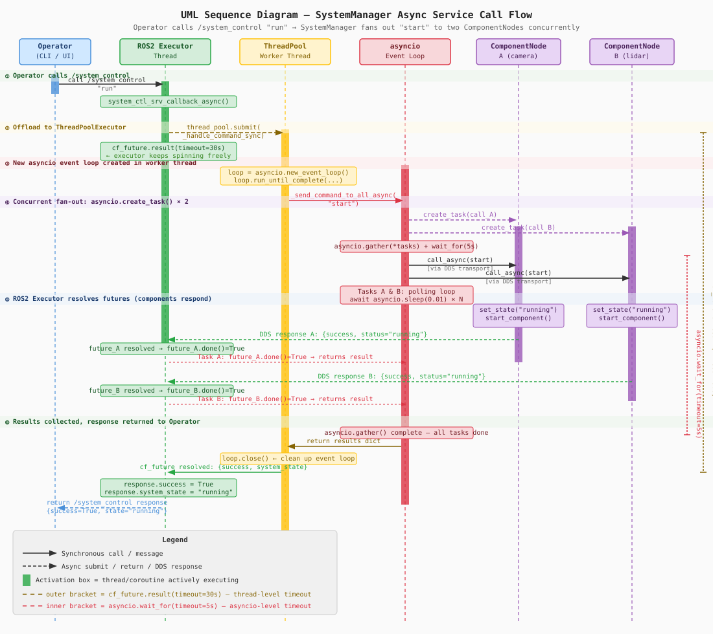

# SystemManager & ComponentNode

---

# 1. Features and Functions

## SystemManager (`system_manager_node.py`)

`SystemManager` is the central orchestrator of the system, implemented as a ROS2 node named `system_manager`. It manages system lifecycle, monitors all component nodes, provides shared services, and coordinates state transitions.

---

### Configuration Management

At startup, `SystemManager` calls `_initialize_configs()`, which parses a set of YAML/JSON config files from a specified folder (e.g. `data_stream.yaml`, `hardware.yaml`, `demo.yaml`) and all per-component configs found under the `component_node/` sub-folder. Everything is stored in a single dictionary `self.all_configs` keyed by config name. Configs can be retrieved with dot-notation (e.g. `component_node.my_component`). Because the directory is scanned dynamically, adding a new config file requires no code changes.

---

### System State Machine

The node tracks a global `system_state` with values: `disconnected`, `paused`, `running`, or `error`. Transitions are triggered by commands arriving over the `/system_control` service:

| Command | Action Taken | Resulting State |
|---|---|---|
| `run` / `start` / `restart` | Sends `start` to all components | `running` |
| `pause` | Sends `pause` to all components | `paused` |
| `stop` / `urgent_stop` | Sends `urgent_stop` to all components | `disconnected` |
| `checkup` | Starts background health probe | `paused` (if all OK) |
| `status` / `state` | Reads current state, no side effects | (unchanged) |

---

### Component Monitoring

`SystemManager` subscribes to the `component_states` topic and maintains a live dictionary `self.component_statuses` keyed by `layer_cn_id`. On every incoming `ComponentStatus` message, `component_states_callback` updates this dictionary. If the system is in `running` or `paused` state and a component reports `error`, `disconnected`, or `stopped`, `_handle_component_error()` is called, which broadcasts `urgent_stop` to all components and transitions the system back to `disconnected`.

---

### Centralized Logging Service

**Purpose and Design**

Rather than each component writing to its own log file independently, all logging is routed through `SystemManager` via the `/logging` ROS2 service. This ensures that every log entry from every node — regardless of which machine or process it runs on — is collected, timestamped, and stored centrally in organized log files.

**How a Component Sends a Log**

In `ComponentNode.logging()`, the component builds a `Logging.Request` and fires it off as a non-blocking async call:

```python
def logging(self, msg: str, log_level: str = "INFO"):
    req = Logging.Request()
    req.layer_cn_id = self.layer_cn_id   # identifies the sender
    req.log_level   = log_level           # INFO, WARN, ERROR, DEBUG, MONITOR_*, LATENCY_*
    req.message     = msg
    req.timestamp   = self.get_clock().now().to_msg()

    future = self.logging_client.call_async(req)
    return future   # not awaited — fire and forget
```

The call is fire-and-forget: `call_async()` returns a future but the component does not wait for it. This keeps the component's main logic unblocked.

**How SystemManager Handles It**

In `logging_srv_callback`, `SystemManager` receives the request and routes it to the correct file:

```python
def logging_srv_callback(self, request, response):
    log_entry = f"{request.layer_cn_id}: {request.message}"

    if "MONITOR" in request.log_level:
        log_file = os.path.join(self.monitor_log_folder, f"{request.log_level}.log")
    elif "LATENCY" in request.log_level:
        log_file = os.path.join(self.latency_log_folder, f"{request.log_level}.log")
    else:
        log_file = self.system_log_file   # default: system log

    self.logging(log_file, log_entry, request.log_level)
```

**Log Routing Logic**

| `log_level` value | Destination file |
|---|---|
| `INFO`, `WARN`, `DEBUG` | `/log/system/system_{timestamp}.log` |
| `ERROR`, `FATAL` | `/log/system/system_{timestamp}.log` (also echoed to console) |
| `MONITOR_*` (e.g. `MONITOR_CAMERA`) | `/log/monitor/MONITOR_CAMERA.log` |
| `LATENCY_*` (e.g. `LATENCY_image_raw`) | `/log/latency/LATENCY_image_raw.log` |

Each log file is opened in append mode (`'a'`) so entries from multiple components accumulate in chronological order. The internal `SystemManager.logging()` method also mirrors entries to the ROS2 console logger so logs appear in the terminal in real time.

**Why This Matters**

Without centralized logging, each component running in its own process or Docker container would write isolated log files scattered across the filesystem. By routing everything through a single service, the architecture achieves: a unified timeline across all nodes, a clean separation of concern (components just call `self.logging()`), and specialized log files for latency and monitoring data that are easy to parse post-run.

---

### Background System Checkup

On startup (and on the `checkup` command), `SystemManager` launches a background daemon thread that asynchronously polls all expected components. It retries until all components report `ready` or `running`, or a 30-second timeout expires. On success the system transitions to `paused`. The full async mechanism is covered in Section 6.

---

## ComponentNode (`component_node.py`)

`ComponentNode` is an abstract base class that all concrete component nodes inherit. It provides the communication backbone, lifecycle hooks, config loading APIs, and latency measurement infrastructure. It is never instantiated directly.

---

### Component Node Initialization: `_initialize_node()` Step by Step

`_initialize_node()` is the sequence that brings a component from `disconnected` to `ready`. It must be called explicitly by the concrete subclass (typically at the end of its own `__init__`). Here is what happens in order:

<!-- ```
_initialize_node()
    │
    ├─ Step 1: _load_root_configs()          ← defined in the concrete child class
    │
    ├─ Step 2: register_pub_sub()            ← abstract, defined in concrete subclass
    │
    ├─ Step 3: register_latency_sub_pub()    ← defined in ComponentNode base class
    │
    └─ Step 4: check_plugins()               ← abstract, defined in concrete subclass
                │
                ├─ True  → set_state("ready") + _publish_status()
                └─ False → set_state("disconnected") + _publish_status()
``` -->

**Step 1 — `_load_root_configs()`**

This method is defined in the concrete child class, because each component knows which configs it needs. A typical implementation:

```python
def _load_root_configs(self):
    self.hardware_config    = self.load_hardware_config()
    self.data_stream_config = self.load_data_stream_config()
    self.my_config          = self.load_my_config()
```

Each of those methods calls `asyncio.run(self.get_config(...))` internally, which sends a request to `SystemManager`'s `/get_config` service and blocks until the response arrives before continuing to the next line.

**Step 2 — `register_pub_sub()`**

The concrete subclass reads the topic list from config and creates ROS2 publishers and subscribers:

```python
def register_pub_sub(self):
    for topic_cfg in self.data_stream_config["topics"]:
        topic_id = topic_cfg["id"]
        msg_type = self._resolve_msg_type(topic_cfg["msg_type"])

        if topic_cfg.get("publisher") == self.layer_cn_id:
            self.compo_publishers[topic_id] = self.create_publisher(msg_type, topic_id, 10)

        if self.layer_cn_id in topic_cfg.get("subscribers", []):
            self.compo_subscribers[topic_id] = self.create_subscription(
                msg_type, topic_id, self._on_data_received, 10
            )
```

**Step 3 — `register_latency_sub_pub()`**

Called automatically by `_initialize_node()`. For each topic with `latency_test_target: true`:
- If this node is the **publisher** → subscribe to `{topic_id}_pong` to receive echoed messages back.
- If this node is a **subscriber** → create a publisher on `{topic_id}_pong` to echo messages back.

**Step 4 — `check_plugins()`**

The concrete subclass verifies that plugin objects (e.g. a camera driver, a sensor reader) are loaded and respond correctly. Only if this returns `True` does the node publish `ready` status and become eligible to be started by `SystemManager`.

---

### Abstract Interface (must be implemented by subclasses)

| Method | Required Behaviour |
|---|---|
| `register_pub_sub()` | Create all publishers and subscribers from config |
| `register_timer()` | Create ROS2 timers that drive periodic data publishing |
| `urgent_stop()` | Perform hardware-safe immediate shutdown |
| `_load_my_config()` | Load own component-specific config from SystemManager |
| `check_plugins()` | Verify plugin availability and correctness |

---

### Config Loader APIs

| Method | Config Domain |
|---|---|
| `load_data_stream_config()` | Topic definitions and data stream |
| `load_hardware_config()` | Hardware devices, sensors, robots |
| `load_demo_config()` | Demo/recording session settings |
| `load_component_node_config()` | Per-component config file |
| `load_my_config()` | Shortcut for own component config |

<!-- ---

# 2. Communication Between SystemManager and ComponentNode

```
                    ┌─────────────────────────────────────────┐
                    │             SystemManager               │
                    │                                         │
                    │  Services Provided:                     │
                    │  ├─ /logging          (from components) │
                    │  ├─ /get_config       (from components) │
                    │  └─ /system_control   (from operator)   │
                    │                                         │
                    │  Service Clients:                       │
                    │  ├─ /cn_srv_{id_A}    (to Comp A)       │
                    │  └─ /cn_srv_{id_B}    (to Comp B)       │
                    │                                         │
                    │  Subscriber:                            │
                    │  └─ /component_states (from all)        │
                    └────┬──────────────-──────────────┬──────┘
                         │                             │
              calls ▼    │   ▲ status       ▲ logging  │  ▲ get_config
                         │   │              │          │  │
                         ┘   │              │          │  │
                         |   │              │          │  │
┌─────────-───────────┐  |   │    
│   ComponentNode A   │  |   │   
│                     │  |   │   
│ Service Server:     │  |   │    
│  /cn_srv_{id_A} ◄───---┘   │   
│                     │      │   
│ Publisher:          │      │    
│  /component_states ─┼──────┘    
│                     │           
│ Clients:            │          
│  /logging           ┼
│  /get_config   ─────┼
└─────────────────────┘
``` -->

**Channel 1 — `component_states` topic** (Component → SystemManager, one-way): Each component publishes `ComponentStatus` whenever its state changes. SystemManager subscribes and updates `component_statuses`.

**Channel 2 — `cn_srv_{layer_cn_id}` service** (SystemManager → Component, request/response): SystemManager holds one service client per component. Used to send `start`, `pause`, `urgent_stop`, `checkup` commands and receive confirmation.

**Channel 3 — `logging` service** (Component → SystemManager, fire-and-forget): Components call `logging_client.call_async()`. The returned future is not awaited.

**Channel 4 — `get_config` service** (Component → SystemManager, blocking call): Components call this during initialization. The call blocks via `rclpy.spin_until_future_complete()` until the response arrives.

---

# 3. ROS2 Service Calls Summary

For this part please refer to the following part in the [document](ros2_interface.md):

- `system_interfaces/srv/Logging`
- `system_interfaces/srv/GetConfig`
- `system_interfaces/srv/SystemControl`
- `system_interfaces/srv/ComponentService`

<!-- ## Services Provided by SystemManager

### `/logging`
- **Type:** `system_interfaces/srv/Logging`
- **Called by:** Any `ComponentNode`
- **Request:** `layer_cn_id`, `log_level`, `message`, `timestamp`
- **Response:** `success`, `message`
- **Pattern:** Fire-and-forget (`call_async`, future not awaited)

### `/get_config`
- **Type:** `system_interfaces/srv/GetConfig`
- **Called by:** Any `ComponentNode` during initialization
- **Request:** `layer_cn_id`, `config_file_name`, `config_keys` (optional filter)
- **Response:** `success`, `config_data` (JSON string), `message`
- **Pattern:** Synchronous blocking — `spin_until_future_complete()` is used
- **Example:**
  ```python
  config_str = asyncio.run(self.get_config("hardware", ["sensors"]))
  config = json.loads(config_str)
  ```

### `/system_control`
- **Type:** `system_interfaces/srv/SystemControl`
- **Called by:** External operator / UI
- **Request:** `description` (command string)
- **Response:** `success`, `system_state`, `message`, `timestamp`
- **CLI usage:**
  ```bash
  ros2 service call /system_control system_interfaces/srv/SystemControl \
    "{description: 'run'}"
  ```

## Service Provided by each ComponentNode

### `/cn_srv_{layer_cn_id}`
- **Type:** `system_interfaces/srv/ComponentService`
- **Called by:** `SystemManager` only
- **Request:** `command`, `sender`, `timestamp`
- **Response:** `success`, `status`, `message`, `timestamp`

| `command` | Action in Component | Returned `status` |
|---|---|---|
| `checkup` | Read state, no side effects | current state |
| `start` | `set_state("running")` + `start_component()` | `running` |
| `pause` | `set_state("ready")` + `pause_component()` | `ready` |
| `urgent_stop` | `stop_component()` + `urgent_stop()` + `set_state("disconnected")` | `disconnected` | -->

---

# 4. System Lifecycle Control: start, pause, and stop

## How Timers Drive Data Publishing

In ROS2, a **timer** fires a callback at a fixed frequency. In this architecture, timers are the engine of each component's active work: when a timer fires, the component reads a sensor, processes data, or publishes a message. Stopping the timer means the component stops producing data. This is the mechanism behind `start_component()` and `pause_component()`.

Each component stores its timers in `self.compo_timers`, a list populated inside `register_timer()` (implemented by the concrete subclass).

---

## `start_component()` — Entering the Running State

```python
def start_component(self):
    if self.compo_timers == [] or not self.compo_timers:
        self.register_timer()   # first time: create timers
    else:
        for timer in self.compo_timers:
            timer.reset()       # subsequent times: restart cancelled timers
```

**First call (after initialization):** `compo_timers` is empty because `register_timer()` has never been called. It is called now, creating one or more ROS2 timers that immediately begin firing.

**Subsequent calls (resume after pause):** Timers already exist but were cancelled by a previous pause. `timer.reset()` re-arms each timer, resetting its countdown so it begins firing again from now.

**What `register_timer()` typically looks like in a subclass:**

```python
def register_timer(self):
    timer = self.create_timer(
        timer_period_sec=0.1,          # 10 Hz
        callback=self._publish_data    # called every 100 ms
    )
    self.compo_timers.append(timer)
```

<!-- **Full flow when SystemManager sends `start`:**

```
SystemManager._send_command_to_all_components_async("start")
    │
    └─► _component_service_callback receives command="start"
            │
            ├─ set_state("running")
            │   └─ _publish_status() → publishes "running" on /component_states
            │
            └─ start_component()
                ├─ [if first time] register_timer()  ← creates timers, they start firing
                └─ [if resuming]   timer.reset()     ← restarts each cancelled timer
``` -->

---

## `pause_component()` — Halting Data Flow Without Disconnecting

```python
def pause_component(self):
    if self.compo_timers and self.compo_timers != []:
        for timer in self.compo_timers:
            timer.cancel()
```

`timer.cancel()` stops the timer from firing any more callbacks. The timer object is **not destroyed** — it stays in `self.compo_timers` so it can be `reset()` on the next `start`. The component's ROS2 node keeps spinning, publishers and subscribers stay registered, and state becomes `ready`. It simply stops producing data.

<!-- **Full flow when SystemManager sends `pause`:**

```
SystemManager._send_command_to_all_components_async("pause")
    │
    └─► _component_service_callback receives command="pause"
            │
            ├─ set_state("ready")
            │   └─ _publish_status() → publishes "ready" on /component_states
            │
            └─ pause_component()
                └─ for each timer: timer.cancel()
``` -->

---

## `stop_component()` + `urgent_stop()` — Emergency Shutdown

For `urgent_stop`, the service callback always calls both methods in sequence:

```python
# In _component_service_callback for "urgent_stop":
self.stop_component()   # base class — cancel timers + cleanup latency simulation
self.urgent_stop()      # subclass — hardware-specific emergency shutdown
self.set_state("disconnected")
```

```python
def stop_component(self):
    if self.simulate_latency > 0:
        self._cleanup_latency_simulation()   # removes tc qdisc rule
    if self.compo_timers and self.compo_timers != []:
        for timer in self.compo_timers:
            timer.cancel()
```

`stop_component()` handles generic cleanup (cancel timers, remove network latency shaping). `urgent_stop()` is where the concrete subclass does hardware-specific work: closing serial connections, stopping motors, flushing buffers, disabling actuators, etc.

<!-- **State diagram across all lifecycle commands:**

```
         checkup OK
disconnected ──────────────► paused/ready
     ▲                        ▲  │
     │                        |  │  start
     │                   pause|  ┤
     │                        |  │
     │                        |  ▼
     │.                       running
     │
     │  urgent_stop (from running/paused)
     └──────────────────────────┘
``` -->

**Key differences between pause and stop:**

| Aspect | `pause_component()` | `stop_component()` |
|---|---|---|
| Timer state | Cancelled (resumable with `reset()`) | Cancelled (same) |
| Latency cleanup | No | Yes, if active |
| State after | `ready` | `disconnected` |
| Resumable without checkup? | Yes — next `start` calls `timer.reset()` | No — requires full checkup to reach `ready` again |
| `urgent_stop()` called? | No | Yes (by the service callback) |

---

# 5. Latency Measurement: End-to-End Setup Guide

## Concept: Ping/Pong Over Real Data Topics

Rather than using synthetic test messages, latency is measured on the actual data flowing between nodes. The publisher node stamps each message with a unique ID and records the send time. A subscriber node echoes the message back on a shadow topic (`{topic_id}_pong`). When the echo arrives back at the publisher, the round-trip time (RTT) is computed. One-way latency is estimated as `RTT / 2`.

<!-- ```
Publisher Node                          Subscriber Node
      │                                       │
      │── stamp msg with send_id ──►          │
      │── publish on /topic_id    ──►         │
      │                                       │── receive on /topic_id
      │                                       │── pong_reply(topic_id, msg)
      │                                       │── publish on /topic_id_pong
      │◄── receive on /topic_id_pong ─────────│
      │── compute RTT = recv_time - send_time │
      │── log: one_way_latency = RTT / 2      │
``` -->

---

## Step 1: Mark the Topic in `data_stream.yaml`

Enable latency measurement for a topic by adding `latency_test_target: true`:

```yaml
# data_stream.yaml
topics:
  - id: "image_raw"
    msg_type: "sensor_msgs/msg/Image"
    publisher: "camera_node"
    subscribers:
      - "processing_node"
    latency_test_target: true       # ← enables ping/pong for this topic
```

`register_latency_sub_pub()`, called automatically in `_initialize_node()`, reads this flag and sets up the pong infrastructure for both nodes automatically.

---

## Step 2: Publisher Node — Nothing Extra Needed for Stamping

The publisher node calls `self.publish_msg(topic_id, msg)` as normal. This base-class method automatically calls `send_ping()` before publishing:

```python
# In ComponentNode base class:
def publish_msg(self, topic_id: str, msg: Any):
    publisher = self.compo_publishers[topic_id]
    msg = self.send_ping(topic_id, msg)   # stamps send_id if latency is enabled
    publisher.publish(msg)
```

`send_ping()` only stamps the message if a pong subscriber exists for that topic. Calling `publish_msg()` is always safe whether or not latency measurement is configured.

**What `send_ping()` does internally:**

```python
def send_ping(self, topic_id, msg):
    if topic_id not in self.latency_subs:
        return msg   # no latency test for this topic — pass through unchanged

    send_id = str(time.time_ns())

    if hasattr(msg, "send_id"):
        msg.send_id = send_id           # preferred: dedicated field on the message
    else:
        msg.header.frame_id = send_id   # fallback: embed in ROS header

    self.pending_ping_ids[topic_id][send_id] = time.time_ns()
    return msg
```

---

## Step 3: Subscriber Node — Echo the Message Back

The concrete subscriber node must call `self.pong_reply(topic_id, msg)` inside its data callback:

```python
# In your concrete subscriber node:
def _on_image_received(self, msg):
    # ... your processing logic ...

    # Echo the message back for latency measurement
    self.pong_reply("image_raw", msg)
```

`pong_reply()` is defined in `ComponentNode` and only acts if latency measurement is configured for that topic:

```python
def pong_reply(self, topic_id, msg):
    if topic_id in self.latency_pubs:
        self.latency_pubs[topic_id].publish(msg)   # publish on /image_raw_pong
```

---

## Step 4: Latency Results Are Logged Automatically

When the pong message arrives back at the publisher node, `_pong_callback()` fires automatically (registered during `register_latency_sub_pub()`):

```python
def _pong_callback(self, msg, topic_id):
    recv_time = time.time_ns()
    send_id = msg.send_id   # or msg.header.frame_id

    if send_id in self.pending_ping_ids.get(topic_id, {}):
        send_time = self.pending_ping_ids[topic_id].pop(send_id)
        rtt_ms = (recv_time - send_time) / 1e6
        size_bytes = len(serialize_message(msg))

        self.logging(
            f"RTT = {rtt_ms/2.0:.3f} ms; "
            f"Start Timestamp = {send_time/1e6} ms; "
            f"Size = {size_bytes} bytes",
            f"LATENCY_{topic_id}"          # routes to /log/latency/LATENCY_image_raw.log
        )
```

The log level `LATENCY_{topic_id}` causes `SystemManager` to route the entry to the latency log folder automatically.

---

## Complete Latency Flow Summary

```
[data_stream.yaml]  latency_test_target: true
        │
        ▼
_initialize_node() → register_latency_sub_pub()
    ├─ Publisher node:   subscribe to /image_raw_pong  → self.latency_subs["image_raw"]
    └─ Subscriber node:  create publisher /image_raw_pong → self.latency_pubs["image_raw"]

[Runtime — every message cycle]

Publisher node:
  publish_msg("image_raw", msg)
    └─ send_ping() stamps send_id, records send_time in pending_ping_ids
    └─ publishes stamped msg on /image_raw

Subscriber node:
  _on_image_received(msg)
    └─ [your processing]
    └─ pong_reply("image_raw", msg)
    └─ publishes on /image_raw_pong

Publisher node:
  _pong_callback() fires
    └─ computes RTT / 2
    └─ logs to LATENCY_image_raw → SystemManager → /log/latency/LATENCY_image_raw.log
```

---

# 6. Async Process

This section explains the foundational concepts from first principles and then shows how they are applied in `SystemManager`.

---
<!-- 
### What Is an asyncio Event Loop?

An **event loop** is a scheduler that runs in a single thread. It keeps a queue of tasks and advances each one when it is ready to make progress. The key principle is **cooperative multitasking**: a task voluntarily yields control back to the loop by using the `await` keyword when it is waiting for something (e.g. a network response, a timer). While one task waits, the loop runs other tasks. No two tasks truly run at the same time — they take turns on the same thread.

```
Single Thread — Event Loop
─────────────────────────────────────────────────────────►  time
  [Task A runs]
               [Task A hits "await" → suspends itself]
                [Task B runs]
                             [Task B hits "await" → suspends]
                              [Task A resumes, finishes]
                                            [Task B resumes]
```

This is fundamentally different from threading (where multiple threads run simultaneously on multiple CPU cores). With asyncio, there is only one thread, and context switches happen only at `await` points. This makes it very efficient for I/O-bound work (waiting for network or disk) where most time is spent waiting, not computing.

**Creating and running an event loop:**

```python
import asyncio

async def my_task():
    print("task started")
    await asyncio.sleep(1)   # suspend here; loop can run other tasks during this 1s
    print("task finished after 1s")

loop = asyncio.new_event_loop()
loop.run_until_complete(my_task())   # blocks the calling thread until coroutine finishes
loop.close()                         # always close when done
```

`run_until_complete()` blocks the **calling thread** until the coroutine finishes — but inside that 1 second of `asyncio.sleep(1)`, other coroutines can run on that same thread.

---

### What Is `ThreadPoolExecutor`?

`ThreadPoolExecutor` (from Python's `concurrent.futures` module) manages a pool of real OS threads. You submit a function to the pool, it runs in one of the available threads without blocking the caller. The caller gets back a `concurrent.futures.Future` — a handle to the pending result.

```python
from concurrent.futures import ThreadPoolExecutor
import time

pool = ThreadPoolExecutor(max_workers=10)

def slow_work(x):
    time.sleep(2)   # this runs in a worker thread, not in the caller's thread
    return x * 2

# Submit returns immediately; slow_work runs concurrently in a thread
cf_future = pool.submit(slow_work, 5)

# Caller can do other work here...

# When ready, block and get the result (raises TimeoutError if too slow)
result = cf_future.result(timeout=5.0)   # result == 10
```

`concurrent.futures.Future` is a completely separate object from `asyncio.Future` and from ROS2's `Future`. It is a simple thread-safe handle: `done()` tells you if the thread has finished, and `result()` blocks until it does (or times out).

**Why use `ThreadPoolExecutor` in `SystemManager`?**

`SystemManager`'s `/system_control` service callback runs on the ROS2 executor thread. If it does slow work there (calling multiple component services, waiting for responses), it blocks that thread. A blocked executor thread cannot process any other incoming callbacks or service responses — this leads to a deadlock. The fix is to hand off all slow work to the thread pool and return quickly from the callback.

---

### What Is a ROS2 Future?

When you call `client.call_async(request)`, ROS2 immediately returns an `rclpy.task.Future`. This is a promise: "I will fill in the response when it arrives over DDS." The future starts in a pending state.

The **ROS2 executor**, while spinning, watches for incoming service response messages on the DDS (Data Distribution Service) transport layer. When a response message arrives, the executor resolves the corresponding future by setting its result value.

```python
future = client.call_async(request)

# Immediately after call_async:
# future.done()   → False  (response not yet received)
# future.result() → raises exception (not done yet)

# After the executor receives the DDS response message:
# future.done()   → True
# future.result() → ServiceResponse object with the actual data
```

**Critical property:** A ROS2 future is **not** a native Python `asyncio.Future`. You cannot `await` it directly in an asyncio coroutine. For the future to be resolved, the ROS2 executor must be spinning (processing DDS messages). If the executor thread is blocked (e.g. waiting inside a service callback), the future can never be resolved — deadlock.

--- -->

## Why a Naïve Approach Deadlocks

Consider this naïve attempt to call a component service from inside the `/system_control` callback:

```python
# WRONG — This deadlocks
def system_ctl_srv_callback(self, request, response):
    future = self.component_clients["camera"].call_async(req)
    rclpy.spin_until_future_complete(self, future)   # blocks the executor thread!
    # The executor is blocked here waiting for the future,
    # but the future needs the executor to spin to receive the DDS response.
    # Neither can proceed → DEADLOCK
```

The executor thread is blocked inside `spin_until_future_complete`, waiting for `future` to be done. But for `future` to be done, the executor needs to process the incoming DDS response. But the executor thread is blocked. Circular dependency → deadlock.

---

## How `SystemManager` Solves This: Three-Layer Architecture

**Layer 1: ROS2 Executor Thread — stays free**

The service callback only submits work to the thread pool and waits with a timeout. It never calls services itself.

```python
def system_ctl_srv_callback_async(self, request, response):
    # Submit the work to a worker thread — returns immediately
    cf_future = self.thread_pool.submit(
        self._handle_system_command_sync, request.description
    )
    # Wait for the worker thread result (with timeout)
    # The ROS2 executor can still spin and process other callbacks
    result = cf_future.result(timeout=30.0)

    response.success = result['success']
    return response
```

**Layer 2: Worker Thread — runs asyncio**

The worker thread creates its own isolated asyncio event loop and runs the async fan-out logic inside it.

```python
def _handle_system_command_sync(self, description):
    loop = asyncio.new_event_loop()
    asyncio.set_event_loop(loop)
    try:
        results = loop.run_until_complete(
            self._send_command_to_all_components_async("start")
        )
        return {'success': True, 'system_state': 'running', ...}
    finally:
        loop.close()   # always clean up to prevent resource leaks
```

**Layer 3: asyncio Event Loop — concurrent fan-out**

Inside the new event loop, all N component service calls are dispatched simultaneously as asyncio tasks. `asyncio.gather` waits for all of them.

```python
async def _send_command_to_all_components_async(self, command, timeout=5.0):
    tasks = []
    for component_id in self.expected_components:
        client = self.component_clients[component_id]
        request = ComponentService.Request()
        request.command = command

        # Each component call becomes one concurrent asyncio task
        task = asyncio.create_task(
            self._call_component_service_async(client, request)
        )
        tasks.append(task)

    # Wait for all N tasks simultaneously, with a hard timeout
    completed = await asyncio.wait_for(
        asyncio.gather(*tasks, return_exceptions=True),
        timeout=timeout
    )
    return completed
```

---

## Bridging ROS2 Futures to asyncio: The Polling Pattern

`_call_component_service_async` bridges the gap between ROS2 futures and the asyncio world using polling:

```python
async def _call_component_service_async(self, client, request):
    future = client.call_async(request)   # fires the DDS service call, returns ROS2 future

    # Poll until done, yielding control on each iteration
    while not future.done():
        await asyncio.sleep(0.01)         # suspend for 10ms, let other tasks run

    return future.result()
```

Each `await asyncio.sleep(0.01)` does two things simultaneously:
1. It suspends **this coroutine** for 10 ms, yielding the asyncio event loop to other component call tasks.
2. It gives the **ROS2 executor** (spinning in its own thread) time to receive the DDS response and mark the ROS2 future as done.

This works because the asyncio event loop lives in the worker thread, and the ROS2 executor spins in the main thread. They coexist in separate threads and never conflict.

---

## The Complete Flow



<!-- 
```
External operator calls /system_control with "run"
        │
        ▼ (ROS2 Executor Thread)
system_ctl_srv_callback_async()
    │
    ├─ thread_pool.submit(_handle_system_command_sync, "run")
    │   └─► Worker Thread starts (executor thread is now FREE to keep spinning)
    │
    └─ cf_future.result(timeout=30.0)  ← waits, but executor keeps running

        ┌────────── Worker Thread ──────────┐
        │ loop = asyncio.new_event_loop()   │
        │ loop.run_until_complete(          │
        │   _send_command_to_all_async()    │
        │ )                                 │
        │                                   │
        │  asyncio Tasks (concurrent):      │
        │  ├─ Task A: poll future_A (10ms)  │
        │  ├─ Task B: poll future_B (10ms)  │◄──── all run on the same worker thread
        │  └─ Task C: poll future_C (10ms)  │      but yield control every 10ms
        └───────────────────────────────────┘

        ┌────── ROS2 Executor Thread ───────┐
        │ (still spinning normally)         │
        │ receives DDS response for A ──────┼─► future_A.done() = True
        │ receives DDS response for B ──────┼─► future_B.done() = True
        │ receives DDS response for C ──────┼─► future_C.done() = True
        └───────────────────────────────────┘

        asyncio.gather() collects all results
        Worker thread returns result dict to cf_future
        Executor thread unblocks, builds response, returns to operator
``` -->

---

## Deadlock Prevention: Two Independent Timeout Layers

**Inner timeout — asyncio layer (5 seconds)**

`asyncio.wait_for` wraps `asyncio.gather`. If any component takes longer than 5 s, all pending tasks are cancelled and partial results are returned.

```python
try:
    completed = await asyncio.wait_for(
        asyncio.gather(*tasks, return_exceptions=True),
        timeout=5.0
    )
except asyncio.TimeoutError:
    for task in tasks:
        if not task.done():
            task.cancel()
```

**Outer timeout — thread layer (30 seconds)**

`cf_future.result(timeout=30.0)` in the service callback ensures that even if the asyncio layer somehow fails, the ROS2 service callback returns after at most 30 seconds rather than hanging forever.

```python
try:
    result = cf_future.result(timeout=30.0)
except Exception as e:
    success = False
    message = f"Command execution failed: {e}"
```

<!-- ---

## Summary Table: Concurrency Tools Used

| Tool | Where Used | Purpose |
|---|---|---|
| `asyncio.create_task()` | `_send_command_to_all_components_async` | Dispatch N component calls concurrently |
| `asyncio.gather()` | Same | Collect all N results in one await |
| `asyncio.wait_for()` | Same | Hard timeout on the entire group of tasks |
| `await asyncio.sleep(0.01)` | `_call_component_service_async` | Yield control while polling the ROS2 future |
| `asyncio.new_event_loop()` | Worker thread | Isolated event loop per thread — no cross-thread conflicts |
| `ThreadPoolExecutor` | `/system_control` callback | Move slow work off the ROS2 executor thread |
| `concurrent.futures.Future` | `/system_control` callback | Thread-safe handle to the worker thread result |
| `client.call_async()` | Component service call | Non-blocking DDS service request, returns ROS2 future |
| `rclpy.spin_until_future_complete()` | `ComponentNode.get_config()` | Blocking wait for config response at initialization time only | -->